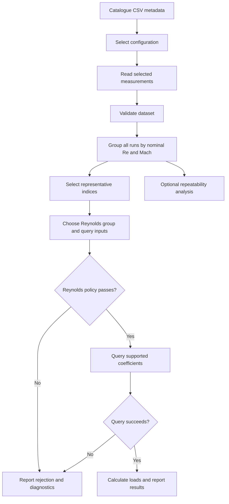

# Architecture

[Repository home](../README.md) · [Module reference](modules/README.md)

The application separates one-time dataset preparation from repeated coefficient queries and physical flight-condition checks. `app/main.f90` owns the interactive session, input conversion, menus and reporting. Modules in `src/` provide the reusable operations described below.

## Preparation and query flow

An altitude solver can supply a geometric altitude before the policy check. It solves a physical Reynolds relationship; coefficient support still needs a separate query. The coefficient module can also be called directly when atmospheric policy is not required.

## Six preparation stages

| Stage | Module / operation | Result and responsibility |
|---|---|---|
| 1. Catalogue | [`dataset_catalogue`](modules/dataset_catalogue.md): `build_run_catalogue` | Recursively discover CRM CSVs and inspect metadata without retaining every measurement array. Discovery currently uses Unix `find`. |
| 2. Select | [`run_selection`](modules/run_selection.md): `select_runs` | Select exact CONFIG, CONFTS and CONFT values. This stage chooses the configuration, not the Reynolds group. |
| 3. Read | [`data_io`](modules/data_io.md): `read_crm_dataset` | Allocate one measurement run per selected file and preserve the selected-run order. |
| 4. Validate | [`dataset_validation`](modules/dataset_validation.md): `validate_dataset` | Inspect configuration consistency, allocations, lengths, finiteness, alpha order/duplicates and Mach/Reynolds validity. Stop preparation if the report is invalid. |
| 5. Group | [`dataset_grouping`](modules/dataset_grouping.md): `group_dataset` | Classify measured run means into supported nominal Re/Mach levels and retain every matching run index. |
| 6. Represent | [`dataset_representative`](modules/dataset_representative.md): `build_representative_dataset` | Choose the widest alpha sweep per combination; break range ties by point count. Store its index rather than copying or averaging measurements. |

Successful parsing alone does not establish a valid dataset. Successful validation alone does not establish that every run falls into the supported nominal classification. Check the validation report and each subsequent operation's status.

## Storage and ownership

[`types`](modules/types.md) defines the shared derived types, including atmosphere and flight-condition results. The two primary products are:

| Object | Contents | Lifetime / invariant |
|---|---|---|
| `data` (`aero_dataset_type`) | All selected runs and their alpha, measured Mach, measured Reynolds and coefficient arrays | Retains repeats. Owns the measurements. |
| `grouped` (`grouped_dataset_type`) | Nominal Reynolds groups, nested Mach groups and arrays of dataset run indices | Contains all classified repeats. Useful for representative selection and repeatability. |
| `structure` (`representative_dataset_type`) | Nominal Reynolds/Mach combinations with one representative `run_index` each | Refers into `data%runs`; owns no replacement coefficient arrays. |

The lookup is `structure%reynolds_groups(i)%mach_groups(j)%run_index`, then `data%runs(run_index)`. Array positions are 1-based. In particular, a Reynolds **group index** is an integer position, not a Reynolds value. The current session reference field is `references%re_number_position`.

Do not reorder, replace or delete runs after building either index structure. A valid in-bounds index can silently reference the wrong run after reordering. Rebuild grouping and representatives whenever the loaded dataset/configuration changes. Geometry and policy changes reuse the prepared measurements and structure.

Grouping and representative order should not be treated as sorted. Catalogue order follows discovery; grouping retains encounter order. The query sorts local sweep indices by nominal Mach. Complete representative ties keep the first encountered candidate, so filesystem discovery order can affect a full tie. The selection policy does not assess experimental uncertainty or average repeated measurements.

## Coefficient query

[`coefficient_query`](modules/coefficient_query.md) consumes the prepared pair and a selected Reynolds group. Its current module name is `coefficient_query`, even though its test file is named `test_coefficient_query_v2.f90`.

For each representative sweep, the query determines alpha support from that run's own closed alpha range. Unsupported sweeps are skipped. Coordinates are measured Mach interpolated linearly at the requested alpha by default, or measured sweep means when explicitly selected. Nominal Mach labels identify and order sweeps.

Supported coordinates must increase strictly in nominal order, including across gaps. An exact Mach-coordinate match uses one sweep; otherwise the nearest supported sweep below and above the query provides the bracket. For example, an unsupported nominal 0.75 sweep does not block interpolation between supported 0.70 and 0.80 sweeps, provided their actual coordinates bracket the request. Crossing/duplicate supported coordinates cause rejection.

The selected alpha method evaluates Cl, Cd and Cm in each required sweep. The results are then interpolated linearly in Mach. There is no Reynolds interpolation or alpha/Mach extrapolation. `akima` is the default and requires five points per selected sweep; `linear` and `pchip` require two. Short runs do not cause an automatic fallback. See the [linear](modules/linear_interpolation.md), [PCHIP](modules/pchip_interpolation.md) and [Akima](modules/akima_interpolation.md) references for exact algorithms and fatal-input behavior.

## Physical flight-condition policy

[`standard_atmosphere`](modules/standard_atmosphere.md) accepts geometric altitude in metres over the inclusive range 0–32,000 m. It converts to geopotential altitude internally and returns dry standard-atmosphere temperature, pressure, density, sound speed and dynamic viscosity.

[`flight_condition_validation`](modules/flight_condition_validation.md) calculates

$$V=Ma\cdot a,\qquad q=\frac12\rho V^2,\qquad Re=\frac{\rho VL}{\mu}.$$

The selected group's nominal Reynolds number is the policy target. The caller supplies a relative tolerance in `[0,1)`; the CLI accepts percent and converts it. A condition must pass that comparison before the coefficient query executes. Acceptance means these explicit policy and support checks passed; it is not a validated aerodynamic error bound.

Observed Reynolds extrema describe all representative sweeps in the selected group. They exclude other groups and discarded repeats, and do not replace the nominal acceptance target. The altitude solver bisects the physical Re relationship at fixed Mach and reference length. Its tolerance is an altitude bracket width, not a Reynolds mismatch allowance.

[`aerodynamic_properties`](modules/aerodynamic_properties.md) converts accepted coefficients to signed lift, drag, pitching moment and Cl/Cd. Reference area, Reynolds length and moment chord must have definitions and scale consistent with the dataset. The routines preserve coefficient signs and the original moment reference point; they do not transform axes or calculate trim.

## Different tolerances have different purposes

| Quantity | Current implementation | Purpose |
|---|---|---|
| Nominal Mach classification | Absolute mean-Mach difference <= 0.004 | Assign a run to one supported label. |
| Nominal Reynolds classification | Relative mean-Re difference <= 0.02 | Assign a run to one supported label. |
| Representative alpha-range tie | Absolute range difference <= 1e-12 | Decide when measurement count breaks a range tie. |
| Query Mach matching/order | Scale-dependent 64 × machine epsilon | Floating-point coordinate comparisons, not aerodynamic uncertainty. |
| Flight Reynolds policy | Caller-selected fraction, plus roundoff allowance | Decide whether physical flight Re is close enough to the selected nominal Re. |
| Altitude solve | Default 0.01 m bracket width | Terminate bisection; does not guarantee a requested relative Re error. |

Classification recognizes Re levels 5, 19.8 and 30 million and Mach labels 0.70, 0.75, 0.80, 0.83, 0.85, 0.86, 0.87, 0.88 and 0.92. Availability depends on the selected data. These lists are implementation constants, not a promise of a complete rectangular grid.

## Responsibility and failure boundaries

| Layer | Checks performed here | Assumptions retained downstream |
|---|---|---|
| Reading | File access, CSV parsing and required fields | No proof of physical or numerical validity. |
| Dataset validation | Shared measurement/configuration invariants | Later modules trust the accepted arrays. |
| Grouping / representative selection | Nominal classification and selection | Structure must remain paired with the original run order. |
| Query | Inputs/method, small reference guards, alpha support, local Mach ordering/bracketing, point count and finite results | Does not rescan every run for upstream invariants. |
| Flight validation | Physical inputs, atmosphere, numeric representability, Reynolds policy and delegated query status | Does not repeat full dataset validation. |
| Loads | Finite inputs, geometry sign/range constraints, representability | Caller ensures coefficient/reference conventions match. |

Status integers are local to each module and are not interchangeable. Check a status before consuming outputs, or inspect `is_valid` for dataset validation. Ordinary query, atmosphere, physical-validation and property failures return statuses and use NaNs for unavailable real results. Flight results preserve diagnostics already calculated and distinguish a query that failed from one not evaluated.

The interpolation primitives use `error stop` for invalid inputs. Preparation and query preconditions are therefore part of correct use; a query status is not a universal recovery mechanism for arbitrary corrupted arrays. Full contracts and status tables are on each module page.

## Diagnostics and analysis

[`dataset_characterisation`](modules/dataset_characterisation.md) summarizes the supplied measurements. [`dataset_repeatability`](modules/dataset_repeatability.md) compares repeats on a common alpha interval using linear alignment, sample standard deviations and spreads. These are diagnostic paths; they do not alter the representative query model or create an uncertainty bound for arbitrary conditions.

The module references link to existing `test/` sources. Run the suite from the repository root with `fpm test --profile debug`; the [root README](../README.md#tests-and-interpolation-validation) describes individual runs and exported interpolation-validation results. Separate test-documentation pages are not part of this documentation package.

## Extending the implementation

Keep input/session handling in `app/main.f90`, shared records in `types`, and reusable numerical policy in the modules. When changing a public interface, update its module page and callers/tests together. Changes to classification, representative policy or array ordering require reviewing the full preparation-to-query contract. Changes to query support need synthetic tests for exact matches, supported gaps, crossing coordinates and boundary rejection in addition to numerical interpolation tests.

The CLI currently applies nominal Mach bounds before the query; the reusable query checks actual supported coordinates. Preserve that distinction when interpreting a CLI rejection or extending the interface. Changing geometry does not require re-reading data, while changing configuration does.
